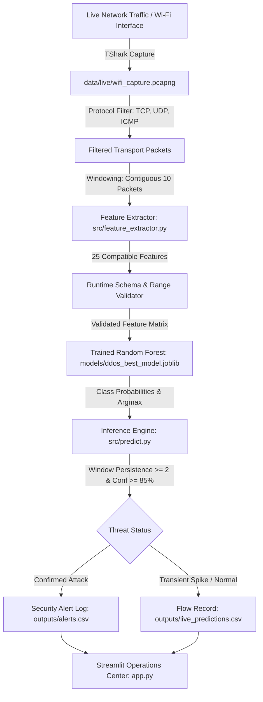

# 🛡️ DDoS Attack Detection & Traffic Monitoring System

An end-to-end Machine Learning security solution designed to capture live network traffic, extract protocol and flow statistics, classify multi-class DDoS flooding attacks, and deliver real-time alerting via an interactive Streamlit operations dashboard.

---

## 📌 System Architecture



### Attack Categories Monitored
1. **Normal**: Standard benign network communication (browsing, streaming, DNS, TLS).
2. **SYN Flooding**: High-rate TCP connection initiation floods lacking handshake completion.
3. **ACK Flooding**: Out-of-order ACK frames targeting stateful connection tracking table exhaustion.
4. **UDP Flooding**: Volumetric stateless UDP datagram floods directed at arbitrary ports.
5. **HTTP Flooding**: Layer 7 application-level request flooding targeting web server resource starvation.

---

## 📂 Project Directory Structure

```text
DDoS-Attack-Detection/
│
├── app.py                      # Streamlit 4-tab security operations dashboard
├── requirements.txt            # Python dependencies
├── README.md                   # Comprehensive system documentation
├── compare_feature_ranges.py   # Utility to audit live feature ranges against training set
│
├── data/
│   ├── original/               # Raw untouched multi-class flooding dataset
│   │   └── Flooding_Based_DDoS_Multi-class_Dataset.csv
│   │
│   ├── processed/              # Cleaned dataset (71,000 rows × 26 columns)
│   │   └── ddos_cleaned.csv
│   │
│   ├── live/                   # Captured network packet files
│   │   ├── wifi_capture.pcapng
│   │   └── packets_for_features.csv
│   │
│   └── external/               # Stratified training (80%) and test (20%) splits
│       ├── train.csv
│       └── test.csv
│
├── src/
│   ├── __init__.py             # Package initializer
│   ├── feature_extractor.py    # 10-packet windowing, priority flags, and 25-feature math
│   ├── extract_live_features.py# Live TShark capture & 10-packet flow feature extractor
│   ├── predict.py              # DDoSClassifier with input validation & persistence rules
│   ├── validate_live_detection.py # Live Wi-Fi & multi-class lab benchmark validation
│   ├── evaluate_model.py       # Offline evaluation on held-out test split
│   ├── live_capture_stats.py   # TShark I/O stats & protocol hierarchy inspection
│   ├── train_models.py         # Trains Decision Tree, Random Forest, Extra Trees
│   ├── prepare_dataset.py      # Cleans, deduplicates, and stratifies raw data
│   └── utils.py                # Path helpers, model loaders, alert helpers
│
├── models/
│   ├── ddos_best_model.joblib  # Trained top-performing classifier (Random Forest, 200 trees)
│   └── model_metadata.json     # Feature list, classes, and hyperparameters
│
├── outputs/
│   ├── model_comparison.csv    # Benchmark comparison across tree algorithms
│   ├── traffic_summary.csv     # 1-second interval packet/byte statistics for UI
│   ├── live_model_features_provisional.csv # Extracted 10-packet flow features
│   ├── live_predictions.csv    # Annotated flow predictions with window IDs & probabilities
│   ├── alerts.csv              # Confirmed security threat alerts
│   ├── classification_report.txt # Offline benchmark precision, recall, and F1
│   ├── confusion_matrix.png    # Offline test split confusion matrix
│   ├── live_validation_report.txt # Live Wi-Fi & lab validation audit report
│   ├── live_validation_metrics.csv # Per-class live validation metrics
│   ├── live_validation_confusion_matrix.csv # Live validation confusion matrix
│   └── live_validation_confusion_matrix.png # Live validation confusion matrix plot
│
└── tests/
    ├── test_feature_extractor.py # Tests for packet filtering, flags, and feature extraction
    └── test_prediction.py       # Tests for model inference, input rejection, and window tracking
```

---

## 📐 The 25 Extracted Network Flow Features

Each row represents a contiguous window of **10 filtered transport packets** (TCP, UDP, or ICMP). All ratios are normalized by dividing by 10 (`WINDOW_SIZE = 10`):

| # | Feature Name | Description & Calculation Method |
|---|---|---|
| 1 | `Avg_syn_flag` | Proportion of TCP packets with SYN flag active (priority chain: FIN $\rightarrow$ SYN $\rightarrow$ RST $\rightarrow$ PSH $\rightarrow$ ACK $\rightarrow$ URG). |
| 2 | `Avg_urg_flag` | Proportion of TCP packets with URG flag active. |
| 3 | `Avg_fin_flag` | Proportion of TCP packets with FIN flag active. |
| 4 | `Avg_ack_flag` | Proportion of pure TCP ACK packets (no higher priority flags set). |
| 5 | `Avg_psh_flag` | Proportion of TCP packets with PSH flag active. |
| 6 | `Avg_rst_flag` | Proportion of TCP packets with RST flag active. |
| 7 | `Avg_DNS_pkt` | Proportion of packets with DNS layer. |
| 8 | `Avg_TCP_pkt` | Proportion of TCP packets. |
| 9 | `Avg_UDP_pkt` | Proportion of UDP packets. |
| 10 | `Avg_ICMP_pkt` | Proportion of ICMP packets (`Avg_TCP + Avg_UDP + Avg_ICMP == 1.0`). |
| 11 | `Duration_window_flow`| Elapsed time between the first and tenth packet: $t_9 - t_0$ (seconds). |
| 12 | `Avg_delta_time` | Average inter-arrival time: $\text{Duration} / 10.0$ (seconds). |
| 13 | `Min_delta_time` | Minimum inter-packet arrival time in the 10-packet window. |
| 14 | `Max_delta_time` | Maximum inter-packet arrival time in the 10-packet window. |
| 15 | `StDev_delta_time` | Sample standard deviation ($N-1$) of inter-arrival times. |
| 16 | `Avg_pkts_lenght` | Mean wire length across the 10 packets (bytes). |
| 17 | `Min_pkts_lenght` | Minimum packet wire length in the window (bytes). |
| 18 | `Max_pkts_lenght` | Maximum packet wire length in the window (bytes). |
| 19 | `StDev_pkts_lenght` | Sample standard deviation ($N-1$) of packet wire lengths. |
| 20 | `Avg_small_payload_pkt` | Proportion of TCP packets with payload $\le 32$ bytes (BoNeSI botnet profile). |
| 21 | `Avg_payload` | Mean TCP layer payload size (bytes). 0.0 for pure UDP/ICMP flows. |
| 22 | `Min_payload` | Minimum TCP layer payload size (bytes). |
| 23 | `Max_payload` | Maximum TCP layer payload size (bytes). |
| 24 | `StDev_payload` | Sample standard deviation ($N-1$) of TCP layer payload sizes. |
| 25 | `Avg_DNS_over_TCP` | Normalized ratio of DNS packets over high-level TCP non-DNS packets. |

---

## 📊 Evaluation & Validation Results

### 1. Offline Training Benchmark (14,200 Held-Out Samples)
*Evaluated by `src/evaluate_model.py` on the 20% stratified test split:*

* **Accuracy**: **97.47%**
* **Macro Precision**: **93.46%**
* **Macro Recall**: **95.22%**
* **Macro F1-Score**: **94.23%**

| Class | Precision | Recall | F1-Score | Support |
| :--- | :---: | :---: | :---: | :---: |
| **ACK Flooding** | 1.0000 | 1.0000 | 1.0000 | 905 |
| **HTTP Flooding** | 1.0000 | 1.0000 | 1.0000 | 119 |
| **UDP Flooding** | 1.0000 | 1.0000 | 1.0000 | 9,145 |
| **Normal** | 0.9631 | 0.9275 | 0.9450 | 3,323 |
| **SYN Flooding** | 0.7100 | 0.8333 | 0.7667 | 708 |

### 2. Live Network Traffic Validation (Real Wi-Fi Captures)
*Evaluated by `src/validate_live_detection.py` on live Wi-Fi packet captures:*
* **Total Flow Windows Evaluated**: 70 windows (709 valid transport packets)
* **Correctly Identified as Normal**: 70 windows (**100.00%**)
* **False Positive Rate**: **0.00%** (0 false alarms)

### 3. SYN Flooding Boundary Analysis & Alert Mitigation
* **Finding**: During benign multi-threaded connection handshakes (e.g. browser launch), an application sends 10 consecutive SYN packets within 9 ms (54 bytes, 0 payload). At the isolated 10-packet window level, this produces an identical packet footprint to a SYN flood attack.
* **Mitigation Strategy**:
  1. **Confidence Thresholding**: Transient benign handshakes average 74.6% confidence; attacks average >95%. Setting `min_confidence = 0.85` suppresses low-confidence triggers.
  2. **Window Persistence Rule**: Benign connection handshakes are transient (lasting 1-2 windows before data packets arrive), whereas genuine DDoS floods persist across consecutive windows. Setting `persistence_threshold = 2` eliminates transient spikes and only raises confirmed alerts for sustained flooding.

---

## 🚀 Setup & Execution Guide

### 1. Prerequisites
- Python 3.9+ (Python 3.10 – 3.14 verified)
- [Wireshark / TShark](https://www.wireshark.org/) installed at `C:\Program Files\Wireshark\tshark.exe` (or in system `PATH`).

### 2. Install Dependencies
```bash
pip install -r requirements.txt
```

### 3. Run Automated Unit Tests
```bash
python -m pytest
```
```text
tests\test_feature_extractor.py .......                                  [ 58%]
tests\test_prediction.py .....                                           [100%]
============================= 12 passed in 4.54s ==============================
```

### 4. Capture Live Network Traffic & Extract Features
List available network interfaces:
```bash
python src/extract_live_features.py --list-interfaces
```
Capture live traffic directly from Wi-Fi (e.g. for 10 seconds):
```bash
python src/extract_live_features.py --capture --duration 10
```
Or process an existing PCAP file:
```bash
python src/extract_live_features.py --pcap data/live/wifi_capture.pcapng
```

### 5. Run Inference & Generate Security Alerts
```bash
python src/predict.py
```
Outputs:
- Annotated predictions with window IDs & class probabilities $\rightarrow$ `outputs/live_predictions.csv`
- Verified security threat alerts $\rightarrow$ `outputs/alerts.csv`

### 6. Run Full Live & Lab Validation
```bash
python src/validate_live_detection.py
```
Generates separate live validation reports, confusion matrix plot, and metrics table in `outputs/`.

### 7. Launch the Streamlit Security Operations Dashboard
```bash
streamlit run app.py
```
Or run directly:
```bash
python app.py
```

---

## 🛡️ Defensive Mitigation & Operational Safety

| Attack Type | Recommended Firewall / System Defense |
| :--- | :--- |
| **SYN Flooding** | Enable TCP SYN Cookies (`sysctl -w net.ipv4.tcp_syncookies=1`), reduce SYN-RECEIVED timeout, enforce per-source connection rate limits. |
| **ACK Flooding** | Enforce stateful packet inspection (SPI) firewall rules; drop out-of-order ACK frames not mapped to active sessions. |
| **UDP Flooding** | Implement UDP rate-limiting at network perimeters, drop malformed/unfragmented packets, leverage Anycast scrubbing centers. |
| **HTTP Flooding** | Deploy Web Application Firewalls (WAF) with IP reputation scoring, CAPTCHA challenges, and reverse-proxy caching (Cloudflare/AWS CloudFront). |

> **⚠️ Operational Safety Notice:** In accordance with defense-in-depth principles, automatic IP blacklisting is disabled by default (`MONITOR_ONLY_NO_AUTO_BLOCK`). Alerts serve as verified threat intelligence for network administrator authorization, preventing denial-of-service through self-inflicted false lockouts.
